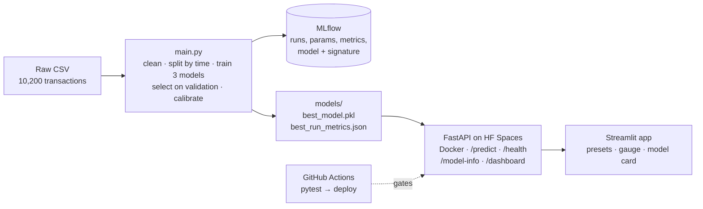

# Real-Time Fraud Detection: from messy data to a live, tested ML service

**A production-style machine learning system that scores money transfers for fraud in real time. It runs as three connected live services, and every release is gated by automated tests.**

[](https://github.com/Jaywestty/Fraud-detection-ML/actions/workflows/deploy.yml)


| 🖥️ Try it | 🔌 API | 📊 Model report |
|---|---|---|
| [**Live app**](https://fraud-detect-mll.streamlit.app) | [Interactive API docs](https://jayywestty-frauddetection-ml.hf.space/docs) | [Live dashboard](https://jayywestty-frauddetection-ml.hf.space/dashboard) |

---

## ⚡ Impact at a glance

| | |
|---|---|
| 🎯 **4.5× more fraud caught** | Reviewing the riskiest 5% of transactions catches **23% of fraud**, compared with 5% for random review. |
| 📈 **4.7× better than chance** | Test PR-AUC is **0.073** against a 1.55% fraud base rate, measured on future transactions the model never saw. |
| 🐛 **9 production issues found and fixed** | An audit of the original system found leakage, train/serve skew, and features that never reached the model. All are fixed, and the code-level ones are guarded by tests. |
| 🧹 **1,482 corrupted values repaired** | Typos, junk labels, placeholder numbers and broken timestamps, plus 200 duplicate rows, cleaned automatically on every request. |
| ✅ **22 automated tests gate every deploy** | A broken model or API can't reach production. |
| 🚀 **3 live services, deployed by CI/CD** | Streamlit app, FastAPI service on Hugging Face (Docker), MLflow experiment tracking. |

---

## 👔 For recruiters and hiring managers

**In one sentence:** I took a fraud model that *looked* finished, found the reasons its numbers couldn't be trusted, rebuilt it into a reliable end-to-end service, and reported results that hold up on future data.

### The story

The first version worked on the surface: a model, an API and a web app, with a PR-AUC of 0.067. Auditing it the way a production ML team would turned up problems no dashboard would show:

- **Most of the engineered features never reached the model.** 7 of the 9 were computed, then silently thrown away by the preprocessing step.
- **The live API computed features differently from training.** For example, "cross-border" meant *not in the US* in production, but *IP country ≠ home country* in training.
- **The score was inflated.** The model was chosen and its threshold tuned on the same test set used to report results, and a random split let the same customers appear in training and testing. One customer accounts for 45% of all fraud.
- **Bad inputs failed silently.** The app's default KYC value (`tier_1`) didn't exist in the training data, so it quietly became "all zeros".

I fixed each one at the root, added a test so it can't come back, and re-measured honestly on a held-out *future* time period. The result is a model I can defend in a review, not just a number.

### Skills this project demonstrates

| Skill | Where to see it |
|---|---|
| **ML evaluation rigour**: leakage detection, time-based validation, calibration, confidence intervals | [`main.py`](main.py), [`src/evaluate.py`](src/evaluate.py) |
| **Feature engineering without train/serve skew** | [`src/features.py`](src/features.py): one sklearn transformer shared by training and serving |
| **Data quality engineering** | [`src/clean.py`](src/clean.py) |
| **Production API design**: typed validation, health checks, versioned responses | [`api/app.py`](api/app.py) |
| **MLOps**: experiment tracking, CI/CD, containerisation | MLflow, [GitHub Actions](.github/workflows/deploy.yml), [`Dockerfile`](Dockerfile) |
| **Testing ML systems**: parity tests, schema contracts, API tests | [`tests/`](tests) |
| **Product thinking**: metrics a fraud team actually uses, a UI people can use | [`streamlit_app/`](streamlit_app/streamlit_app.py) |
| **Engineering judgement**: reporting limitations honestly | [Limitations](#-honest-limitations-and-roadmap) |

---

## 🙋 For non-technical readers

**What it does:** you describe a money transfer (how much, from which country, on what device, how old the account is) and the system answers straight away: *how likely is this to be fraud, and should someone review it?*

**Why it matters:** fraud teams can't check every transaction. This system ranks transactions by risk so reviewers spend their time where fraud actually is. If a team can review only 1 in 20 transactions, following the model's ranking finds **4.5 times more fraud** than picking at random.

**Try it in 30 seconds:**
1. Open the [live app](https://fraud-detect-mll.streamlit.app).
2. Choose **"Suspicious pattern"** or **"Typical customer"**, or change any field yourself.
3. Click **Check transaction**. You'll see a risk gauge, a verdict (✅ looks legitimate, ⚠️ monitor, 🚨 flag for review), and the red flags in the transaction in plain English.

**Can you trust it?** The sidebar shows how the model performed on recent transactions it had never seen, including a margin of error. Nothing is hidden behind a single impressive number.

---

## 🛠️ For engineers

### Architecture



**One pipeline, end to end.** The pickled model is a single scikit-learn `Pipeline`:

```
raw JSON → Pydantic validation → FraudFeatures (clean + engineer) → impute / scale / one-hot → calibrated XGBoost → probability
```

Because cleaning and feature engineering live *inside* the model artifact, the API sends raw fields and gets exactly the features used in training. There's no second copy of the logic that can drift, and a test checks this.

### Results

The model is trained on the oldest 60% of transactions, selected and threshold-tuned on the next 20%, and scored **once** on the most recent 20%, the way it would face real future traffic.

| Split | Period | Rows | Fraud |
|---|---|---|---|
| Train | Oct 2022 → Jul 2024 | 6,000 | 127 |
| Validation | Jul 2024 → Mar 2025 | 2,000 | 37 |
| Test | Mar 2025 → Dec 2025 | 2,000 | 31 |

| Test-set metric (XGBoost, calibrated) | Value |
|---|---|
| PR-AUC | **0.073** (95% bootstrap CI 0.029–0.178) |
| Random-model PR-AUC (= base rate) | 0.0155 |
| Recall when reviewing the top 5% riskiest | **23%** (random: 5%) |
| Precision in the top 2% riskiest | 12.5% (8× the base rate) |
| ROC-AUC | 0.73 |

Validation PR-AUC for the three candidates: XGBoost 0.100, RandomForest 0.066, LogisticRegression 0.050.

### Bugs found and fixed

| # | Problem in the original system | Impact | Fix |
|---|---|---|---|
| 1 | `ColumnTransformer` dropped 7 of 9 engineered features | The model never saw its key signals | All 13 engineered features are declared once; a test fails if any is dropped |
| 2 | API re-implemented features differently (`cross_border = home != "US"`) | Train/serve skew in production | Feature logic lives in the pickled pipeline; parity test |
| 3 | Notebook cleaning never reached `src/` | Typos became separate categories; placeholder values like `9999.99` read as real fees | `src/clean.py` repairs 1,482 values |
| 4 | Model and threshold chosen on the test set | Optimistic, biased score | Selection and threshold use validation only; test is scored once |
| 5 | Random split with heavy customer concentration | Leakage across splits | Chronological split |
| 6 | 200 duplicate transactions | Rows on both sides of the split | De-duplicated before splitting |
| 7 | SMOTE plus class weights | Double-corrected, uncalibrated probabilities (thresholds 0.014–0.82) | Class weights + sigmoid calibration |
| 8 | Hard-coded 0.5 threshold; unknown categories silently zeroed | Wrong decisions, invisible input errors | Tuned threshold served from the report; `422` on invalid input |
| 9 | Missing `xgboost` dependency; CI deployed without tests; deploy action broke on an upstream CLI rename | Fragile releases | Split, pinned requirements; tests gate deploy; pinned `hf` CLI |

### Data quality

The raw data is deliberately messy. [`src/clean.py`](src/clean.py) repairs, on every training run *and* every API request:

| Issue | Examples | Count |
|---|---|---|
| Misspelt or inconsistent categories | `mobille`, `weeb`, `MOBILE`, `' mobile  '`, `standrd`, `NAN`, `unknown` | 838 |
| Placeholder numbers | `fee = -1 / 9999.99`, `device_trust_score = -0.1`, `txn_velocity_1h = -1` | 612 |
| Malformed timestamps | `N/A`, `0000-00-00T00:00:00Z`, `2025/13/40 25:61:00` | 32 |
| Duplicate transactions | same `transaction_id` repeated | 200 rows |

### Features

13 engineered features on top of the raw fields, all learned without leakage (any data-derived cut-off is fitted on the training split only):

- **Amount:** log amount, fee-to-amount ratio
- **Time:** hour of day, weekend, night-time (00:00–04:59)
- **Geography and device:** cross-border (IP country ≠ home country), new device with low trust
- **Velocity:** 1h/24h velocity ratio, velocity × amount, young-account velocity, new-account flag
- **Composite:** risk pile-up count, currency corridor (e.g. `GBP->NGN`)

### Design decisions

| Decision | Why |
|---|---|
| Chronological split | Fraud models always predict the future; random splits leak customers and fraud campaigns. |
| Validation-only selection and threshold | Choosing the best of N models on the test set inflates the result. |
| Class weights + calibration instead of SMOTE | Calibrated scores mean what they say: 6% ≈ a 6% chance. |
| PR-AUC, top-k recall, bootstrap CI | Accuracy is meaningless at a 1.5% base rate; top-k recall matches a fraud team's review budget; the CI shows how uncertain the estimate is. |
| Invalid input → `422`, missing input → imputed | Errors are visible, never silently turned into zeros. |
| Fixed category copies in the UI, checked by a test | The Streamlit deploy stays lightweight but can't drift from the model's schema. |

### API

| Endpoint | Description |
|---|---|
| `POST /predict` | Raw transaction → `fraud_probability`, `prediction`, `threshold`, `risk_level`, `model_version` |
| `GET /health` | Liveness and loaded model version |
| `GET /model-info` | Full training report (JSON) |
| `GET /dashboard` | Training report as an HTML page |

```bash
curl -X POST https://jayywestty-frauddetection-ml.hf.space/predict \
  -H "Content-Type: application/json" -d '{
  "amount_usd": 250, "fee": 3, "source_currency": "USD", "dest_currency": "NGN",
  "channel": "mobile", "home_country": "US", "ip_country": "US", "kyc_tier": "standard",
  "account_age_days": 400, "chargeback_history_count": 0, "new_device": false,
  "location_mismatch": false, "ip_risk_score": 0.2, "device_trust_score": 0.8,
  "risk_score_internal": 0.2, "corridor_risk": 0.0, "txn_velocity_1h": 0, "txn_velocity_24h": 1
}'
```

`ip_country`, `exchange_rate_src_to_dest` and `timestamp` are optional. Invalid categories or out-of-range scores return `422` with details.

### Testing and CI/CD

22 pytest tests run on every push and pull request. A push to `main` deploys to Hugging Face Spaces **only if they all pass**.

- **Data:** typo and sentinel repair, timestamp parsing, de-duplication
- **Features:** every engineered feature reaches the model; no infinities; cut-offs learned from training data only
- **Train/serve parity:** scoring one row alone gives the same features as scoring it in a batch
- **Evaluation:** splits are strictly chronological, and the test set contains fraud
- **API contract:** valid and invalid payloads, tuned threshold, risk ordering, dashboard
- **UI/schema sync:** Streamlit dropdowns match the training categories

### Project layout

```
├── main.py                  Train → select → calibrate → evaluate → log to MLflow
├── run.py                   Local API runner
├── Dockerfile               API image: serving deps only, non-root, health check
├── requirements-api.txt     Serving dependencies (pinned)
├── requirements.txt         Training + tracking + tests
├── src/
│   ├── schema.py            Raw inputs and allowed categories (single source of truth)
│   ├── clean.py             Stateless data repair, shared by training and serving
│   ├── features.py          FraudFeatures sklearn transformer
│   ├── pipeline.py          Features → preprocessing → classifier
│   ├── models.py            Candidate models and imbalance handling
│   ├── data.py              Loading, de-duplication, chronological split
│   └── evaluate.py          PR-AUC, top-k metrics, threshold, bootstrap CI
├── api/app.py               FastAPI service
├── streamlit_app/           Frontend (deployed separately)
├── models/                  Production model + training report
├── tests/                   22 tests
└── FRAUD_DETECTION.ipynb    Exploratory analysis
```

### Run it locally

```bash
python -m venv .venv && source .venv/bin/activate   # Windows: .venv\Scripts\activate
pip install -r requirements.txt

python main.py      # train and evaluate; writes models/ and mlruns/
pytest              # 22 tests
python run.py       # API at http://127.0.0.1:8000/docs
mlflow ui           # experiment runs at http://127.0.0.1:5000
```

Frontend, in a second terminal:

```bash
pip install -r streamlit_app/requirements.txt
echo "API_URL=http://127.0.0.1:8000" > .env
streamlit run streamlit_app/streamlit_app.py
```

### Tech stack

| Layer | Tools |
|---|---|
| Modelling | scikit-learn, XGBoost, probability calibration |
| Experiment tracking | MLflow (nested runs, params, metrics, signatures, artifacts) |
| Serving | FastAPI, Pydantic, Uvicorn, Docker |
| Frontend | Streamlit, Plotly |
| Quality | pytest, GitHub Actions |
| Hosting | Hugging Face Spaces (API), Streamlit Community Cloud (app) |

---

## 🧭 Honest limitations and roadmap

Good ML engineering means knowing where a model stops being reliable:

- **Small sample, weak signal.** There are 195 fraud cases in total, and one customer accounts for 45% of them. The test set has 31 fraud cases, so the confidence interval is wide. More labelled fraud would help more than more tuning.
- **No customer-history features yet.** The strongest fraud signals are usually relative to a customer's own behaviour (unusual amount, time since last transfer, devices per customer). These need a feature store at serving time. *Next step.*
- **Tree models don't extrapolate.** Inputs far beyond the training range can score lower than intuition suggests.
- **Roadmap:** serve from the MLflow Model Registry · log predictions and monitor drift · API-key auth on `/predict` · scheduled retraining
