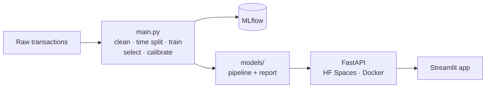

# Fraud Detection ML

An end-to-end machine learning system that scores money transfers for fraud risk. It covers data cleaning, leakage-free feature engineering, time-based evaluation, MLflow experiment tracking, a FastAPI prediction service on Hugging Face Spaces, and a Streamlit frontend, with tests gating every deploy.

[](https://github.com/Jaywestty/Fraud-detection-ML/actions/workflows/deploy.yml)


**Live:** [Web app](https://fraud-detect-mll.streamlit.app) · [API docs](https://jayywestty-frauddetection-ml.hf.space/docs) · [Model dashboard](https://jayywestty-frauddetection-ml.hf.space/dashboard)

## Highlights

- Reviewing the riskiest 5% of transactions catches **23% of fraud**, 4.5× more than random review, measured on a later time period the model never saw.
- Cleaning and feature engineering live inside the model artifact, so training and serving use identical code, and a test enforces it.
- An audit of the first version found leakage, train/serve skew, and engineered features that never reached the model. The [fixes](#engineering-notes) are covered by 22 tests that run before every deploy.
- Repairs 1,482 corrupted values (typos, placeholder numbers, malformed timestamps) and 200 duplicate rows in the raw data.

## Results

The data (10,000 unique transactions, 1.95% fraud) is split chronologically. Models are trained on the oldest 60%, selected and threshold-tuned on the next 20%, and evaluated once on the most recent 20%.

| Split | Period | Rows | Fraud |
|---|---|---|---|
| Train | Oct 2022 – Jul 2024 | 6,000 | 127 |
| Validation | Jul 2024 – Mar 2025 | 2,000 | 37 |
| Test | Mar 2025 – Dec 2025 | 2,000 | 31 |

Selected model: calibrated XGBoost. On validation, its PR-AUC was 0.100, compared with 0.066 for RandomForest and 0.050 for LogisticRegression.

| Test metric | Value |
|---|---|
| PR-AUC | 0.073 (95% bootstrap CI 0.029–0.178) |
| PR-AUC of a random model (base rate) | 0.0155 |
| Recall in the top 5% of scores | 23% |
| Precision in the top 2% of scores | 12.5% |
| ROC-AUC | 0.73 |

The model ranks fraud about 4.7× better than chance. With only 31 fraud cases in the test period the estimate is noisy, which is why the confidence interval is reported.

## How it works



The saved model is a single scikit-learn pipeline that takes raw transaction fields:

```
FraudFeatures (clean + engineer) → impute / scale / one-hot → XGBoost (sigmoid-calibrated)
```

- **Cleaning** ([`src/clean.py`](src/clean.py)) normalises categories (`mobille`, `MOBILE`, `' mobile  '` → `mobile`), turns placeholder values (`fee = 9999.99`, `device_trust_score = -0.1`) and junk labels into missing values, and parses messy timestamps.
- **Features** ([`src/features.py`](src/features.py)) add 13 signals: log amount, fee ratio, hour, weekend and night flags, cross-border (IP country ≠ home country), new device with low trust, velocity ratios, account-age interactions, a risk pile-up count, and the currency corridor. Data-derived cut-offs are fitted on the training split only.
- **Imbalance** is handled with class weights, then sigmoid calibration, so a score of 0.06 means roughly a 6% chance of fraud.
- **The decision threshold** is chosen on validation and served by the API alongside the model version.

## Engineering notes

Issues found in the original implementation, and how they were fixed:

| Issue | Fix |
|---|---|
| `ColumnTransformer` silently dropped 7 of 9 engineered features | Every feature is declared once; a test fails if one is unused |
| API re-implemented features differently (`cross_border = home_country != "US"`) | Feature code lives in the pickled pipeline; train/serve parity test |
| Notebook data cleaning never ported to the training code | Shared `clean()` used in training and at inference |
| Model selection and threshold tuning done on the test set | Validation-only selection; test scored once |
| Random split, with one customer holding 45% of all fraud | Chronological split; duplicates removed first |
| SMOTE combined with class weights gave uncalibrated scores | Class weights + calibration |
| Hard-coded 0.5 threshold; unknown categories silently encoded as zeros | Tuned threshold served; invalid input returns `422` |
| Missing dependencies; deploys ran without tests | Pinned, split requirements; CI runs pytest before deploying |

## Quickstart

```bash
python -m venv .venv && source .venv/bin/activate   # Windows: .venv\Scripts\activate
pip install -r requirements.txt

python main.py      # train and evaluate; writes models/ and mlruns/
pytest              # run the test suite
python run.py       # API at http://127.0.0.1:8000/docs
mlflow ui           # browse experiment runs
```

To run the frontend against a local API:

```bash
pip install -r streamlit_app/requirements.txt
echo "API_URL=http://127.0.0.1:8000" > .env
streamlit run streamlit_app/streamlit_app.py
```

## API

| Endpoint | Description |
|---|---|
| `POST /predict` | Score a transaction: returns probability, decision, threshold, risk level, model version |
| `GET /health` | Service status and loaded model version |
| `GET /model-info` | Latest training report (JSON) |
| `GET /dashboard` | Training report as HTML |

```bash
curl -X POST https://jayywestty-frauddetection-ml.hf.space/predict \
  -H "Content-Type: application/json" -d '{
  "amount_usd": 250, "fee": 3, "source_currency": "USD", "dest_currency": "NGN",
  "channel": "mobile", "home_country": "US", "ip_country": "US", "kyc_tier": "standard",
  "account_age_days": 400, "chargeback_history_count": 0, "new_device": false,
  "location_mismatch": false, "ip_risk_score": 0.2, "device_trust_score": 0.8,
  "risk_score_internal": 0.2, "corridor_risk": 0.0, "txn_velocity_1h": 0, "txn_velocity_24h": 1
}'
```

`ip_country`, `exchange_rate_src_to_dest` and `timestamp` are optional. Unknown categories or out-of-range values return `422`.

## Project structure

```
├── main.py               Training, model selection, evaluation, MLflow logging
├── src/
│   ├── schema.py         Input columns and allowed categories
│   ├── clean.py          Data cleaning shared by training and serving
│   ├── features.py       Feature engineering transformer
│   ├── pipeline.py       Full model pipeline
│   ├── models.py         Candidate models
│   ├── data.py           Loading, de-duplication, chronological split
│   └── evaluate.py       Metrics, threshold selection, bootstrap CI
├── api/app.py            FastAPI service
├── streamlit_app/        Frontend
├── models/               Production model and training report
├── tests/                Unit, parity and API tests
├── Dockerfile            API image
└── .github/workflows/    Test and deploy pipeline
```

## Limitations and next steps

- **Small sample.** 195 fraud cases in total, and one customer accounts for 45% of them. More labelled fraud would improve the model more than further tuning.
- **No customer-history features.** Signals such as amount compared with a customer's usual spend, or time since their last transfer, need a feature store at serving time.
- **Extrapolation.** Tree models can under-score inputs far outside the training range.
- **Planned:** serve from the MLflow Model Registry, monitor prediction drift, add API authentication, schedule retraining.
